# FPGA Real-Time Image Edge Detection & Filtering Accelerator

Bu proje, **Sipeed Tang Nano 20K (Gowin GW2AR-18)** FPGA geliştirme kartı üzerinde çalışan donanımsal görüntü filtreleme (Gaussian Blur) ve kenar algılama (Sobel Edge Detection) hızlandırıcısı ile modern bir **PyQt5 Masaüstü Arayüzü (GUI)** içermektedir.

Sıfırdan yazılmış Verilog RTL mimarisi ile donanım seviyesinde çalışan konvolüsyon filtreleri, Block RAM (BSRAM) tabanlı hat tamponları (Line Buffer) ve PC ile güvenilir yüksek hızlı haberleşme (460,800 Baud UART) entegre edilmiştir.

---

## 🌟 Öne Çıkan Özellikler

- **Donanımsal 3x3 Gaussian Blur:** Görüntüdeki yüksek frekanslı gürültüyü donanımda ortadan kaldıran $3\times 3$ ağırlıklı filtre kernel'i ($[1, 2, 1; 2, 4, 2; 1, 2, 1] / 16$).
- **Donanımsal 3x3 Sobel Kenar Algılama:** Yatay ($G_x$) ve Dikey ($G_y$) gradyan matrisleri üzerinden kenar türevi ve donanımsal eşikleme (Thresholding).
- **Dinamik Çözünürlük Desteği:** 128x128'den **1024x1024** ve 16:9 **1024x576**'ya kadar donanımı yeniden sentezlemeden çalışma zamanında çözünürlük değiştirme.
- **Canlı Video & Webcam İşleme Modu:** Video dosyalarını (.mp4, .avi) veya bilgisayar kamerasını (Webcam) kare kare FPGA'dan geçirip yan yana canlı oynatma ve işlenmiş çıktıyı `output_video.mp4` olarak dışa aktarma.
- **Dinamik Eşik Değeri (Runtime Thresholding):** Video oynarken veya görsel işlenirken anlık ayarlanabilir kenar hassasiyeti.
- **Ultra Yüksek Hızlı UART (1.35 Mbaud):** 27 MHz sistem saatinde sıfır hata ile 1,350,000 Baud hızında çalışan (CLKS_PER_BIT=20), 64-bayt lock-step aktarımlı ve dahili 256-bayt FIFO'lu haberleşme köprüsü.
- **Knight Rider LED Animasyonu:** FPGA görsel ve video işlerken kart üzerindeki 6 LED ile ping-pong görsel durum göstergesi.
- **Modern Çift Sekmeli PyQt5 Arayüzü:** Fotoğraf Modu ve Video Modu arasında tek tıkla geçiş, canlı FPS ve ilerleme göstergeleri.

---

## 📐 Sistem Mimarisi

```mermaid
flowchart LR
    subgraph PC ["Bilgisayar (Python PyQt5 GUI)"]
        UI["Kullanıcı Arayüzü"]
        Rescale["Gri Tonlama & Yeniden Boyutlandırma"]
        LockStep["64-Byte Lock-Step UART Köprüsü (460.8k Baud)"]
        UI --> Rescale --> LockStep
    end

    subgraph FPGA ["Sipeed Tang Nano 20K (Gowin GW2AR-18)"]
        RX["UART RX (Pin 70)"]
        FSM["Protokol Çözücü & Header FSM\n[Thresh, W_hi, W_lo, H_hi, H_lo]"]
        LB1["Line Buffer 1 (1024-genişlik BSRAM)"]
        GAUSS["Gaussian Blur Filter (3x3 Kernel)"]
        LB2["Line Buffer 2 (1024-genişlik BSRAM)"]
        SOBEL["Sobel Gradient Engine (|Gx| + |Gy|)"]
        FIFO["Circular Buffer (256-Byte FIFO)"]
        TX["UART TX (Pin 69)"]
        LEDS["Knight Rider 6-LED PWM Chaser (Pins 15-20)"]

        RX --> FSM
        FSM --> LB1
        LB1 --> GAUSS
        GAUSS --> LB2
        LB2 --> SOBEL
        SOBEL --> FIFO
        FIFO --> TX
        FSM -. Aktiflik Tetikleyici .-> LEDS
    end

    LockStep <== USB-UART Köprüsü ==> RX
    TX <== İşlenmiş Kenar Baytları ==> LockStep
```



---

## 🧮 Matematiksel Modeller

### 1. Gaussian Blur (Gürültü Azaltma)
Yüksek frekanslı kamera ve iletim gürültüsünü filtrelemek için $3\times 3$ Gaussian çekirdeği donanımda bit kaydırma (`>> 4`) ile sıfır gecikmeli olarak hesaplanır:
$$K_{gauss} = \frac{1}{16} \begin{bmatrix} 1 & 2 & 1 \\ 2 & 4 & 2 \\ 1 & 2 & 1 \end{bmatrix}$$

$$\text{P}_{blur} = \frac{(P_{00} + P_{02} + P_{20} + P_{22}) + 2(P_{01} + P_{10} + P_{12} + P_{21}) + 4 P_{11}}{16}$$

### 2. Sobel Filtresi & Kenar Gradyanı
Yatay ve dikey yönlü kenar gradyanları:
$$G_x = \begin{bmatrix} -1 & 0 & +1 \\ -2 & 0 & +2 \\ -1 & 0 & +1 \end{bmatrix} * I, \quad G_y = \begin{bmatrix} +1 & +2 & +1 \\ 0 & 0 & 0 \\ -1 & -2 & -1 \end{bmatrix} * I$$

$$|G| = |G_x| + |G_y|$$

$$\text{P}_{edge} = \begin{cases} 255, & \text{eğer } |G| \ge \text{Threshold} \\ 0, & \text{diğer durumlarda} \end{cases}$$

---

## 🔌 Donanım & Pin Bağlantıları (Tang Nano 20K)

| Sinyal Adı | Pin Numarası | Açıklama |
| :--- | :--- | :--- |
| `sys_clk` | **Pin 4** | 27.0 MHz Dahili Kristal Osilatör |
| `uart_rx` | **Pin 70** | BL616 USB-to-UART Köprüsü TX $\to$ FPGA RX |
| `uart_tx` | **Pin 69** | FPGA TX $\to$ BL616 USB-to-UART Köprüsü RX |
| `led[0]` | **Pin 15** | Durum LED'i 0 (Aktif Low) |
| `led[1]` | **Pin 16** | Durum LED'i 1 (Aktif Low) |
| `led[2]` | **Pin 17** | Durum LED'i 2 (Aktif Low) |
| `led[3]` | **Pin 18** | Durum LED'i 3 (Aktif Low) |
| `led[4]` | **Pin 19** | Durum LED'i 4 (Aktif Low) |
| `led[5]` | **Pin 20** | Durum LED'i 5 (Aktif Low) |

> **Önemli Not:** Tang Nano 20K üzerinde Pin 88 (S1 Butonu) SPI Flash boot `MODE0` pinine bağlı olduğu için donanımsal reset olarak kullanılmamış; FPGA açılışında otomatik devreye giren 100.000 döngülük (~3.7 ms) güvenli dahili **Power-On Reset (POR)** bloğu tasarlanmıştır.

---

## 📂 Dosya Yapısı

```
FpgaEdgeDetect/
├── constraints/
│   └── tang_nano_20k.cst          # Gowin Fiziksel Pin ve Voltaj Kısıtları
├── impl/
│   └── pnr/fpga_edge_detect.fs    # Sentezlenmiş Bitstream Dosyası
├── python/
│   ├── gui_app.py                 # PyQt5 Çift Modlu (Fotoğraf + Video) Masaüstü Uygulaması
│   ├── process_image.py           # Tekil Fotoğraf CLI Test ve Doğrulama Betiği
│   ├── process_video.py           # Video Dosyası CLI Test Betiği
│   ├── generate_sample_video.py   # Test için Sentetik Animasyon Video Üretici
│   └── requirements.txt           # Python Bağımlılıkları (PyQt5, pyserial, opencv, numpy)
├── rtl/
│   ├── edge_detect_top.v          # En Üst Düzey Donanım Modülü & FSM
│   ├── line_buffer.v              # BRAM Tabanlı 1024-Piksel Hat Tamponu
│   ├── gaussian_filter.v          # 3x3 Donanımsal Gaussian Konvolüsyon Bloğu
│   ├── sobel_filter.v             # 3x3 Donanımsal Sobel Grad & Thresholding
│   ├── fifo.v                     # 256-Byte Saat Eşzamanlı Çevrimsel Tampon
│   ├── uart_rx.v                  # 460,800 Baud Alıcı (Metastability Filtreli)
│   └── uart_tx.v                  # 460,800 Baud Verici
├── fpga_edge_detect.gprj          # Gowin EDA Proje Dosyası
└── README.md                      # Proje Dokümantasyonu
```

---

## 🚀 Başlangıç & Kurulum

### 1. Gereksinimler
- **Python 3.8+**
- **Gowin EDA V1.9.9+** (Programmer aracı için)
- **Sipeed Tang Nano 20K** kartı

### 2. Python Ortamının Kurulması
```bash
cd python
pip install -r requirements.txt
```

### 3. Bitstream'in FPGA'ya Yüklenmesi
1. Tang Nano 20K kartını USB-C portu üzerinden bilgisayara bağlayın.
2. **Gowin Programmer** aracını açın.
3. Cihaz taraması yapın (`Scan Device` $\to$ `GW2AR-18C`).
4. Operation ayarını `SRAM Program` (geçici test) veya `Embedded Flash Program` (kalıcı) olarak seçin.
5. `impl/pnr/fpga_edge_detect.fs` dosyasını seçip **Program / Configure** butonuna tıklayın.

### 4. Masaüstü Arayüzünün Başlatılması
```bash
python python/gui_app.py
```
1. Otomatik olarak tespit edilen COM portunu seçin (örneğin `COM6`).
2. İstediğiniz çözünürlüğü seçin (`128x128`, `256x256`, `512x512`, `1024x1024`, `1024x576`).
3. İstediğiniz bir görseli yükleyin (`Görsel Seç`).
4. Eşik değerini (Threshold) kaydırarak gerçek zamanlı önizlemeyi inceleyin.
5. **FPGA'ye Gönder ve İşle** butonuna basın. İşlem sırasında kart üzerindeki LED'lerin hareketini izleyin ve sonucu anında görüntüleyin!
